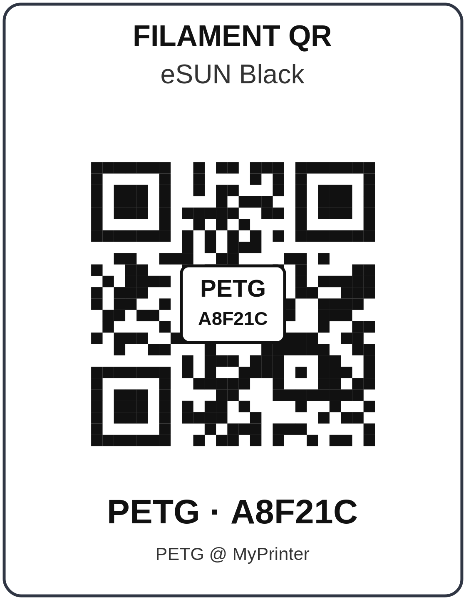

# Filament QR — QR-этикетки катушек для OrcaSlicer

Плагин привязывает каждую катушку к профилю филамента OrcaSlicer и печатает для неё QR-этикетку 56 × 72 мм.
Сфотографируйте этикетку телефоном — OrcaSlicer предложит поставить этот профиль в выбранный слот филамента.



## Установка

Плагин версионируется отдельно от OrcaSlicer, текущая версия — 1.4.0. Нужен официальный OrcaSlicer 2.5.0 или новее.

1. Скачайте `orca_filament_qr.py` из раздела Releases этого репозитория.
2. Подготовьте OrcaSlicer 2.5.0 или новее с [официальной страницы](https://github.com/SoftFever/OrcaSlicer/releases).
3. В OrcaSlicer откройте окно **Плагины** (Plugins), нажмите
   **Установить локальный плагин** (Install local plugin) и выберите файл. OrcaSlicer сам установит зависимости (`qrcode`, `Pillow`, `zxing-cpp`).
   Подтвердите запрошенные разрешения: открытие сокета на `127.0.0.1` и `0.0.0.0` (сервер для телефона),
   пробное подключение к `192.0.2.1`, по которому плагин определяет IP-адрес компьютера (пакеты не отправляются),
   и фоновые потоки. Выданные разрешения видны и меняются в окне «Плагины».
4. В верхней панели рядом с вкладками «Подготовка» и «Предпросмотр» появится вкладка **Filament QR**.
   Если её нет, включите плагин в окне «Плагины».

## Как пользоваться

1. **Новая катушка.** Выберите профиль филамента (в списке только совместимые с текущим принтером).
   Материал, производитель, цвет и цена за кг подставятся из профиля (`filament_type`, `filament_vendor`,
   цвет по умолчанию, `filament_cost`) — при необходимости измените их, добавьте заметку и нажмите
   «Создать катушку и этикетку». На этикетке: производитель и цвет вверху, в центре QR — код катушки, внизу —
   материал и заметка (без заметки — имя профиля).
   Этикетку можно распечатать из браузера: адрес вида `http://127.0.0.1:8765/label/FQ-XXXXXX`.
2. **Телефон.** Включите «Разрешить доступ из локальной сети» → «Применить».
   Наведите камеру телефона на QR-код адреса на странице плагина (или откройте адрес `http://<IP компьютера>:8765/`
   вручную) и введите PIN.
   Windows может спросить разрешение брандмауэра — разрешите для частной сети.
3. **Сканирование.** На телефоне выберите слот и сфотографируйте QR (или введите код вручную).
   OrcaSlicer спросит «Выбрать профиль филамента? Слот N: «старый» → «новый», Цвет: #RRGGBB»; после «Да» профиль
   окажется в слоте. Цвет слота плагин выставит сам, если OrcaSlicer даёт плагинам такую возможность
   (`orca.host.preset.filament.set_slot_colour`). В OrcaSlicer 2.5.0 её ещё нет: плагин покажет, какой цвет задать
   в слоте вручную.
   Если у профиля филамента есть несохранённые правки, OrcaSlicer спросит, что с ними делать, как при обычном выборе.
4. Выбрать катушку можно и с компьютера: кнопка «Выбрать» рядом с катушкой.

Слоты на экране нумеруются с 1, как в OrcaSlicer.

## Очередь сканирований

Каждое сканирование сначала записывается в базу, поэтому оно не теряется при закрытии OrcaSlicer.
Одновременно выбирается только одна запись, остальные ждут своей очереди.
Если вы ответили «Нет» в окне подтверждения, профиль несовместим или такого слота нет, запись остаётся в очереди
с пояснением — её можно повторить или убрать.

## Режимы

- **Автоматический** — OrcaSlicer 2.5.0 и новее: профиль выбирается через API пресетов OrcaSlicer после окна
  подтверждения.
- **Версии до 2.5.0** — у них нет приватного хранилища плагинов, поэтому плагин сообщает об этом
  и не сохраняет данные.

## Если не распознаётся фото

Распознавание использует Pillow и zxing-cpp, которые OrcaSlicer устанавливает вместе с плагином. Плагин проверяет их
при открытии страницы. Если импорт не удался, вверху страницы появится красная строка с точной причиной (например,
`ImportError: DLL load failed ...`). Пришлите этот текст разработчику. Пока распознавание недоступно, код с этикетки
можно ввести вручную.

`ImportError: DLL load failed while importing zxingcpp` в версиях до 1.3.1 на Windows: OrcaSlicer 2.5.0 не кладёт
`python3.dll`, без которой не загружается zxing-cpp 3.x. С версии 1.3.1 на Windows x64 ставится zxing-cpp 2.3, которой
эта библиотека не нужна: переустановите плагин, OrcaSlicer заменит пакет. На Windows ARM64 подходящей сборки
zxing-cpp нет, там коды вводятся вручную.

## Безопасность

- Сервер по умолчанию слушает только `127.0.0.1`. Доступ из сети включается вручную.
- Соединение идёт по HTTP без шифрования — используйте только в доверенной домашней сети, не открывайте порт в интернет.
- Вход по 6-значному PIN; не более 6 неверных попыток в минуту с одного адреса.
- Сессия телефона истекает через 8 часов бездействия и не позже чем через 24 часа.
  «Новый PIN» и «Отключить телефоны» сразу завершают все сессии.
- Размер фото ограничен 6 МБ; слишком большие изображения отклоняются до распознавания.

## Данные

База `filament_qr.sqlite3` и `settings.json` лежат в приватной папке плагина внутри каталога данных OrcaSlicer
(`plugin_data`, путь выдаёт `orca.host.plugin.storage()`). Для резервной копии достаточно скопировать эту папку, пока OrcaSlicer закрыт.

## Разработка

```bash
python3 -m pip install "qrcode>=7.4,<9" "Pillow>=10,<13" "zxing-cpp>=2.3,<4"  # на Windows x64: "zxing-cpp>=2.3,<3"
python3 -m unittest discover -s plugins/filament_qr/tests -t plugins/filament_qr -v
# сервер для телефона без OrcaSlicer:
python3 plugins/filament_qr/orca_filament_qr.py --data /tmp/fq
```
